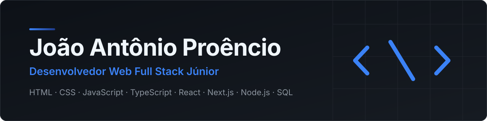

 

  
  
  

---

## Sobre mim

Sou desenvolvedor web Full Stack Júnior. Trabalho com a stack web moderna, do front-end ao back-end: HTML, CSS e JavaScript na base, TypeScript e React nas interfaces, Node.js e Express no servidor, e SQL com Supabase para os dados. Gosto de construir projetos completos, com código organizado, testes e versionamento com Git, e acompanho como a IA pode ser aplicada ao desenvolvimento no dia a dia.

---

## Tecnologias

| Categoria | Tecnologias |
| --- | --- |
| **Front-end** |       |
| **Back-end** |   |
| **Dados** |   |
| **Ferramentas** |   |
| **IA** |  |

---

## Projetos

<table>
  <tr>
    <td width="50%" valign="top">
      <h3><a href="https://github.com/jooaoantoniio/jp-help-desk">JP Help Desk</a></h3>
      Sistema de Service Desk de TI para abrir, atribuir, acompanhar e encerrar chamados, com perfis de acesso, histórico por chamado e dashboard de indicadores.  
      
      
      
      
    </td>
    <td width="50%" valign="top">
      <h3><a href="https://github.com/jooaoantoniio/project-de-sistema-financeiro">Sistema Financeiro</a></h3>
      Protótipo de sistema financeiro em HTML, CSS e JavaScript, com telas de login, dashboard, transações e calculadora.  
      
      
      
    </td>
  </tr>
  <tr>
    <td width="50%" valign="top">
      <h3><a href="https://github.com/jooaoantoniio/fincalc">FinCalc</a></h3>
      Calculadoras financeiras: juros compostos, parcelamento (Price e SAC), salário líquido CLT, orçamento pela regra 50/30/20 e metas de economia.  
      
      
      
      
    </td>
    <td width="50%" valign="top">
      <h3><a href="https://github.com/jooaoantoniio/Projetcs">DevJourney</a></h3>
      Portfólio e diário de estudos do curso, com linha do tempo, dashboard de progresso e gerenciador de tarefas de estudo com cronômetro. Sem frameworks e sem etapa de build.  
      
      
      
    </td>
  </tr>
  <tr>
    <td width="50%" valign="top">
      <h3><a href="https://github.com/jooaoantoniio/Curso-harve">Curso Harve</a></h3>
      Repositório com atividades do curso. Ainda sem descrição detalhada.  
      
    </td>
    <td width="50%"></td>
  </tr>
</table>

---

## GitHub Stats

<table>
  <tr>
    <td align="center" valign="top">
      
    </td>
    <td align="center" valign="top">
      
    </td>
  </tr>
</table>

 

 

 

## Snake Contribution

<picture>
  <source media="(prefers-color-scheme: dark)" srcset="https://raw.githubusercontent.com/jooaoantoniio/jooaoantoniio/main/dist/github-contribution-grid-snake-dark.svg"/>
  
</picture>

---

João Antônio Proêncio · 2026

